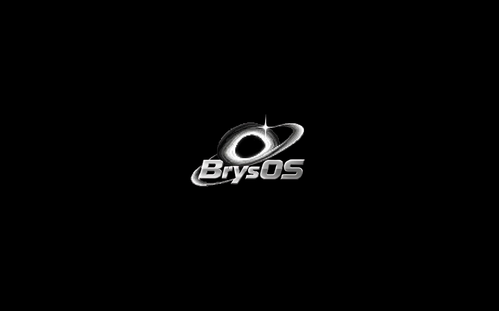
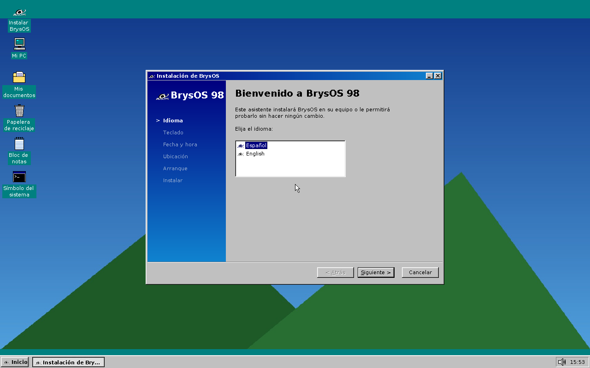
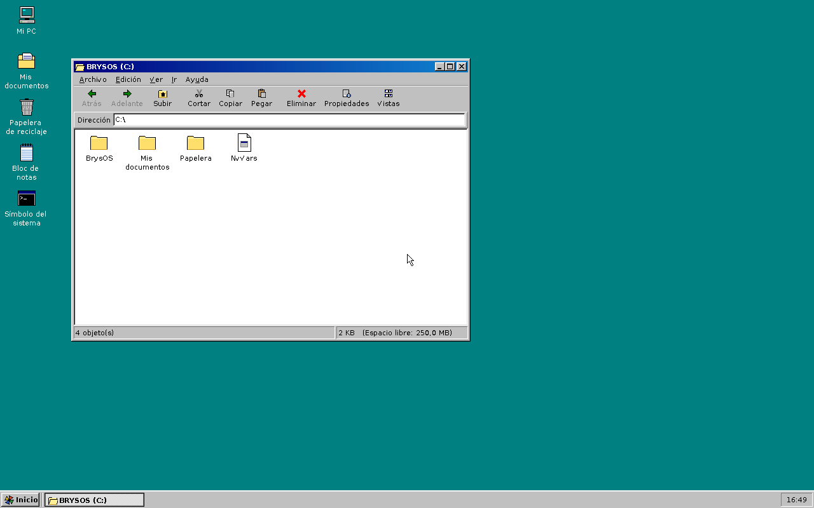
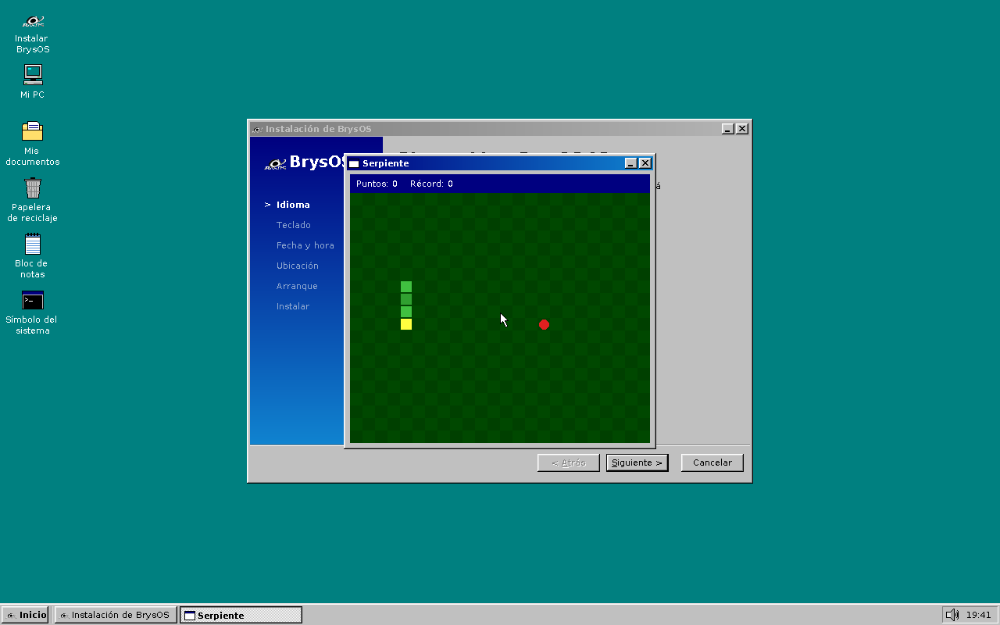
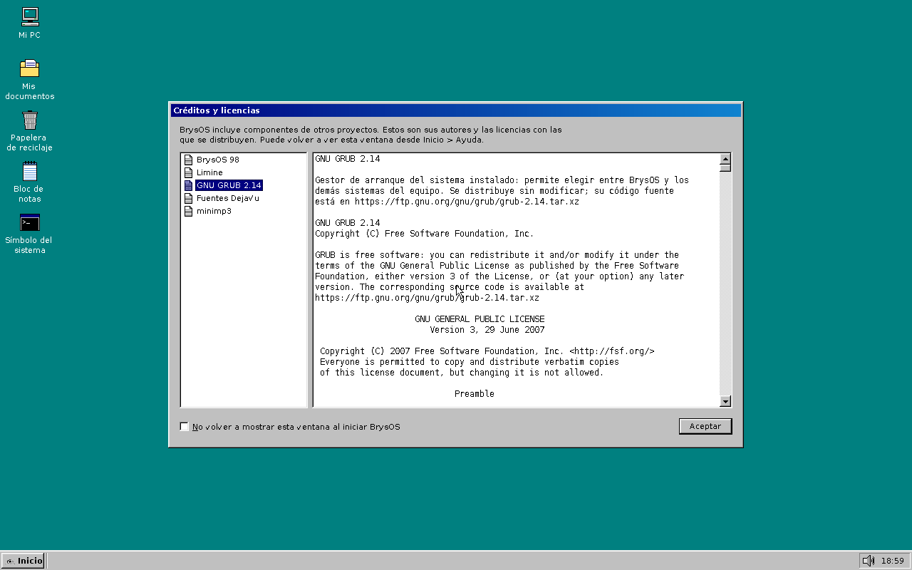

<p align="center"></p>

# BrysOS 98

Sistema operativo de 64 bits escrito desde cero en C++ (con algo de ensamblador), con
aspecto de Windows 98 SE, en español o en inglés. Se arranca desde un pendrive (o la ISO en
una máquina virtual), se instala en el disco y arranca con **GRUB**, que permite elegir entre
BrysOS y los demás sistemas del equipo.

> 🤖 **Un benchmark para IA: sistema creado por Claude.** BrysOS es un experimento para ver
> hasta dónde llega una IA escribiendo un sistema operativo de verdad, desde cero y sobre
> hardware real. Casi todo el código lo ha escrito **Claude** (Anthropic), con
> **erikbryson2401** como director del proyecto: él decide qué se hace, lo prueba en un HP
> Pavilion dv5 de 2009 y trae de vuelta los fallos, los registros y las fotos de pantalla.
> Por eso los commits llevan a los dos como coautores.

**Descargas:** la ISO y los paquetes de actualización de cada versión están en
[Releases](https://github.com/erikbryson2401/BrysOS/releases). Lo que cambia en cada una, en
[CHANGELOG.md](CHANGELOG.md). Equipo de referencia: un HP Pavilion dv5 (Core 2 Duo T6400).

| | |
|---|---|
|  |  |
| Asistente de instalación | Explorador / Mi PC |
|  |  |
| Serpiente, un programa `.run` en modo usuario | Créditos y licencias |

## Qué incluye

| Parte | Implementación |
|---|---|
| Arranque | Núcleo Multiboot2. La ISO usa Limine (BIOS y UEFI); el sistema instalado, GRUB 2 |
| Núcleo | GDT/TSS, IDT, PIC, PIT a 1000 Hz, paginación propia (mapa directo + PAT), montón |
| Pantalla | Framebuffer VBE/GOP con combinación de escritura, doble búfer y composición por regiones |
| Teclado | PS/2 y USB; distribuciones España, Latinoamérica y EE. UU. (teclas muertas, AltGr) |
| Ratón | PS/2, IntelliMouse (rueda) y USB; touchpad Synaptics en modo absoluto |
| USB | EHCI (USB 2.0, alta velocidad), UHCI y OHCI, concentradores, teclado y ratón HID, pendrives (Bulk-Only + SCSI) de lectura y escritura con conexión en caliente y "Expulsar" |
| Sonido | Intel HD Audio y AC'97 con búfer circular alimentado por el reloj; volumen general, silencio y teclas de volumen; WAV y MP3 |
| Discos | AHCI (SATA) por DMA, ATA/IDE; tablas MBR (con lógicas) y GPT |
| Archivos | FAT32 de lectura y escritura con nombres largos, atributos y formateo |
| Instalación | Asistente: idioma, teclado, fecha/hora/zona, partición, GRUB (BIOS o UEFI) |
| Actualización | Paquetes `.bsi` que se aplican desde el propio sistema (Actualizador de BrysOS) |
| Bibliotecas | `.bsl` (como los `.dll`): `lenguajes.bsl`, `images.bsl` y `sonido.bsl`, cargadas al arrancar |
| Programas | `.run` (como los `.exe`): en modo usuario, cada uno con su memoria, multitarea apropiativa; si uno falla o se cuelga, el resto sigue (Ctrl+Alt+Supr: "Cerrar programa") |
| Energía | Intérprete de AML propio (el código de las tablas ACPI) y controlador empotrado: batería, cargador y brillo de la pantalla; apagado (S5), reinicio y botón de encendido |

Aplicaciones: Explorador / Mi PC, Bloc de notas, Paint (guarda BMP; abre también PNG, JPEG y
GIF), Visor de imágenes (con "Usar como fondo"), Reproductor de sonido (WAV y MP3),
Calculadora, Símbolo del sistema (DIR, CD, COPY, MOVE, DEL, REN, MD, RD, TYPE, TREE, ATTRIB,
LABEL, DISPOSITIVOS, BSL, ACPI, SONIDO, ENERGIA, REGISTRO, redirección `>`/`>>`, archivos
`.BAT`), Buscar, Buscaminas, Ejecutar, Panel de control (volumen general y del sonido de
inicio, fondo de escritorio), Fondo de escritorio (centrado, mosaico, expandido o ajustado),
Medidor de energía (en la barra de tareas: carga, tiempo restante y brillo), Propiedades de
Fecha y hora, Propiedades, Papelera de reciclaje y Ayuda. Programas `.run` de ejemplo: Hola y
Serpiente (Inicio > Programas).

## Bibliotecas del sistema (.bsl)

Las `.bsl` (*Brysox Standard Library*) son bibliotecas compartidas, como los `.dll` de
Windows: código compilado aparte (ELF de 64 bits, independiente de la posición) que el núcleo
carga **al arrancar**. GRUB las deja en memoria junto con el núcleo (`module2` en `grub.cfg`),
y el núcleo enlaza sus llamadas con la tabla de funciones que exporta. Cada biblioteca ofrece
una tabla de funciones con número de versión que las aplicaciones piden por nombre.

| Biblioteca | Qué hace |
|---|---|
| `lenguajes.bsl` | Todos los textos de las ventanas. Al cambiar de idioma se traducen también las ventanas abiertas |
| `images.bsl` | BMP, PNG (todos los tipos, entrelazado), JPEG (secuencial y progresivo, EXIF) y GIF animado |
| `sonido.bsl` | WAV de 8/16/24/32 bits o coma flotante y MP3 (también MP2, con [minimp3](https://github.com/lieff/minimp3), de dominio público), cualquier frecuencia, convertido a 48 kHz |

- Están en `C:\BrysOS\BSL` y se pueden actualizar una a una con un paquete `.bsi`.
- El núcleo lleva una copia de reserva de cada una: si falta alguna en el disco, la vuelve a
  escribir y arregla `grub.cfg`. Si una no se puede cargar, el sistema arranca igualmente y
  avisa (orden `BSL` del Símbolo del sistema).
- Las bibliotecas se ejecutan dentro del núcleo, como los controladores de Windows 98: una con
  un fallo grave puede colgar el sistema.

## Programas (.run)

Los `.run` son los ejecutables de BrysOS (como los `.exe`): programas de 64 bits en C que se
ejecutan en **modo usuario**, cada uno con su propio espacio de direcciones. Se abren con doble
clic, desde Ejecutar (por la ruta o sólo por el nombre: `serpiente`) o desde Inicio >
Programas (`C:\Archivos de programa`).

- Si un programa hace algo no válido (memoria ajena, división por cero...), BrysOS lo cierra
  con el aviso "Este programa ha realizado una operación no válida" y lo demás sigue igual.
- Si se queda colgado, **Ctrl+Alt+Supr** abre "Cerrar programa" (marca "no responde") y
  "Finalizar tarea" lo termina. El reloj reparte el procesador cada 10 ms.
- Usan ventanas, botones, campos de texto, lienzos para dibujar, temporizadores, archivos y
  las `.bsl` (`traducir` con `lenguajes.bsl`, `imagen_cargar` con `images.bsl`).

El SDK está en `sdk/` (cabecera `brysos.h`, biblioteca y guía en `sdk/README.md`); cada
carpeta de `programas/` se compila como un `.run` que va dentro del sistema.

## Créditos y licencias

BrysOS incluye componentes de otros proyectos (Limine, GRUB, las fuentes DejaVu, minimp3).
En el primer arranque del sistema instalado aparece la ventana **Créditos y licencias** con sus
autores y licencias; se cierra con Aceptar y vuelve a salir en cada arranque hasta marcar "No
volver a mostrar" (`OcultarCreditos` en `config.ini`). También se abre desde Inicio > Ayuda o
con Ejecutar > `creditos`.

Los textos están en `licencias/NN-nombre.txt` (formato en `licencias/LEEME.txt`) y van dentro
del núcleo. **Al portar código de otro proyecto, añada allí su licencia.**

## Drivers de Linux (en desarrollo)

Para la red, BrysOS usa drivers del núcleo **Linux 6.12** sin modificarlos, sobre una capa de
compatibilidad propia (`kernel/src/linux/`, GPLv2):

- `include/linux/`: cabeceras que imitan las de Linux (printk, kmalloc, listas, cerrojos, PCI,
  DMA, modelo de dispositivos...) y `include/linux/kconfig.h`, que hace de `.config`.
- `brys/base.c`: su implementación en C; `brys/glue.cpp`: la frontera con BrysOS (memoria,
  tiempo, PCI, IRQ, hilos).
- `drivers/`: los archivos de Linux tal cual. Por ahora `drivers/ssb` (el bus interno de las
  tarjetas WiFi Broadcom como la BCM4322 del HP dv5).

Los drivers corren en **hilos del núcleo** cooperativos (como Linux en un solo procesador sin
expropiación) y pueden compartir líneas de IRQ. La capa arranca la primera vez que se usa la
orden **`RED`** del Símbolo del sistema, que guarda un informe (`red.txt`) en el pendrive:
tarjetas de red, núcleos internos de la Broadcom, SPROM (MAC, país) y si está el firmware de
`b43` en `C:\BrysOS\Firmware\b43`. Ese firmware no se puede redistribuir y nunca va en el
repositorio ni en la ISO.

Prueba en QEMU (sin tarjeta Broadcom): `tools/test_red.sh`.

## Energía (ACPI)

El firmware describe la batería, el cargador y el brillo con **AML**, un código que el
sistema tiene que ejecutar. BrysOS lleva su propio intérprete (`kernel/src/acpi/aml.cpp`):
carga la DSDT y las SSDT, ejecuta `_REG` e `_INI` como Windows y lee `_BIF`/`_BST`, `_PSR` y
`_BCL`/`_BCM`/`_BQC`. El controlador empotrado (EC) de los portátiles se usa por los puertos
de su `_CRS`. Con las tablas del HP Pavilion dv5 da los mismos resultados que ACPICA
(`acpiexec`) en los 200 métodos que se pueden ejecutar sin argumentos.

- En la barra de tareas aparece la pila con la carga (y un rayo con corriente); al pulsarla
  se abre el **Medidor de energía** con el tiempo restante y el **brillo** (se guarda).
- Avisos de batería baja al 10 % y al 5 %.
- La orden `ENERGIA [carpeta]` muestra (y guarda en `energia.txt`) todo lo que lee.

## Compilar

Desde PowerShell, en Windows, con las herramientas de `E:\`:

- `E:\msys64`: MSYS2 (UCRT64) con `make`, `nasm`, `xorriso`, `mtools`, `dosfstools`,
  Python con Pillow, `ffmpeg` y QEMU.
- `E:\BrysOS-dev\cross`: compilador cruzado GCC 15.2 + binutils 2.45 para `x86_64-elf`
  (compilado desde el código fuente, con multilib para `-m32`).
- `E:\BrysOS-dev\grub`: GRUB 2.14 (`grub-mkimage` y los módulos `i386-pc` y `x86_64-efi`).
- `E:\BrysOS-dev\rust`: Rust estable con el destino `x86_64-unknown-none`.

```powershell
.\compilar.ps1                        # BrysOS.iso
.\compilar.ps1 qemu                   # compila y arranca en QEMU
.\compilar.ps1 make bsi VERSION=1.3   # cualquier objetivo del Makefile
.\compilar.ps1 prueba test_install.sh # una prueba de tools/
```

En Linux sigue funcionando `make` directamente (con `g++`, `grub-pc-bin`, `grub-efi-amd64-bin`...):
`compilar.ps1` sólo cambia las variables `CROSS`, `GRUB_DIR`, `GRUB_MKIMAGE`, `LIMINE` y `OVMF`.

`BrysOS_logo.png` e `intro.mp3` se convierten durante la compilación y van dentro del núcleo.

## Instalar

1. Grabe `BrysOS.iso` en un pendrive con [Rufus](https://rufus.ie) en **modo imagen DD**
   (o, en VirtualBox, póngala en el lector de la máquina).
2. Arranque desde el pendrive. Se abre el asistente de instalación:
   - **Idioma** (español / inglés) y **distribución del teclado**.
   - **Instalar** o **probar sin instalar** (todo en memoria, no se toca ningún disco).
   - **Fecha, hora y zona horaria** (se escriben en el reloj del equipo).
   - **Ubicación**: un disco entero, un espacio sin asignar (crea una partición nueva) o una
     partición existente (FAT32: formatear o conservar los archivos; otras: se formatean).
   - **Gestor de arranque**: GRUB en el MBR (BIOS) o en la partición del sistema EFI (UEFI).
     Detecta Windows (NTFS / `bootmgfw.efi`) y Linux (ext2/3/4) y los añade al menú.
3. Retire el pendrive y reinicie. Aparece GRUB; al elegir BrysOS se muestra el logo con el
   sonido de inicio (sólo en el primer arranque, o siempre si se marca en el Panel de
   control) y después la pantalla de carga, que avanza con cada paso real del arranque.

Para hacer sitio a BrysOS junto a Windows, reduzca antes un volumen desde *Administración de
discos*. GRUB necesita que la primera partición empiece en el sector 2048 (Vista o
posterior) y se guarda una copia del MBR original en `C:\BrysOS\mbr-original.bin`.

Cada versión publicada se guarda en `iso/BrysOS-x.y.iso` y `bsi/BrysOS-x.y.bsi`
(`make release VERSION=x.y`).

## Actualizar (paquetes .bsi)

Una versión nueva no hace falta instalarla desde cero: basta con un **paquete de
actualización `.bsi`**.

1. En el PC de desarrollo: `make bsi VERSION=1.2` crea `BrysOS-1.2.bsi` con el núcleo y las
   bibliotecas (si existe `notas-1.2.txt`, su texto se muestra en el Actualizador). Para añadir
   otros archivos o borrar alguno se usa `tools/mkbsi.py` directamente (`--delete ruta`,
   `origen:destino`, carpetas enteras).
   - **Desde la 1.0**: use `BrysOS-1.1.bsi`, que sólo trae el núcleo
     (`make bsi VERSION=1.1 BSI_LIBS=0`). El actualizador de la 1.0 tiene un fallo de FAT32 con
     los archivos de nombre corto que estropearía un paquete con varios archivos; el núcleo 1.1
     instala él mismo sus bibliotecas al arrancar. Los paquetes con bibliotecas exigen la 1.1.
2. Copie el `.bsi` a un pendrive FAT32 y conéctelo al equipo con BrysOS en marcha: aparece
   como unidad nueva (D:, E:...) en Mi PC.
3. Haga doble clic en el paquete. El **Actualizador de BrysOS** muestra la versión instalada,
   la del paquete y su contenido; con *Instalar* se aplica y después ofrece reiniciar.

Reglas:

- Todos los archivos del sistema están en `C:\BrysOS` (núcleo `kernel.elf`, `grub.cfg`,
  `config.ini`, `version.txt`...). Esa carpeta está **protegida**: ni el Explorador ni el
  Símbolo del sistema pueden modificarla; sólo la configuración y el Actualizador.
- Un paquete sólo puede tocar `C:\BrysOS`: sobrescribe los archivos que ya existen, crea
  los que faltan (con sus carpetas) y borra los que indica. Las rutas con `..`, letras de
  unidad o caracteres no válidos se rechazan, igual que `grub.cfg`, `config.ini` y los demás
  archivos que gestiona el sistema.
- Antes de sustituir nada se copian los archivos a una carpeta temporal y se comprueba la
  suma CRC-32 de cada uno; si algo falla, el sistema queda como estaba. Después se escribe un
  diario (`update.pending`): si se va la luz a mitad, el siguiente arranque termina la
  actualización.
- Si el paquete trae un núcleo nuevo, el anterior se guarda como `kernel.old` y GRUB añade
  la entrada **BrysOS 98 (versión anterior)**, que además se arranca sola si el núcleo nuevo
  no llega a cargarse. Cada actualización queda anotada en `C:\BrysOS\actualizaciones.log`.
- Los pendrives deben usar FAT32 (MBR o sin tabla). Se pueden leer y escribir; cada cambio se
  escribe en el acto y "Expulsar" (clic derecho en la unidad, en Mi PC) los deja listos para
  quitarlos.

## VirtualBox

La máquina **BrysOS98** ya está creada: SATA (AHCI), ratón y teclado PS/2, sonido HD Audio.
Con *tableta USB* el puntero no funciona (no es un ratón en modo de arranque).

## Limitaciones conocidas

- USB 3 (xHCI) no está soportado: en equipos modernos el teclado/ratón USB depende de la
  emulación PS/2 de la BIOS. Un dispositivo USB 1.1 conectado a un concentrador USB 2.0 no
  funciona (necesitaría transacciones divididas): hay que conectarlo directamente al equipo.
- La batería y el brillo del HP dv5 están probados con sus tablas en el intérprete (frente a
  ACPICA) y en QEMU con una batería simulada, no en el portátil real. No se activa el modo
  ACPI (SCI): las teclas Fn de brillo las atiende la BIOS si lo hace en modo heredado.
- `Load` (tablas cargadas en tiempo de ejecución, gestión de energía del procesador) no está
  implementado.
- Sin red ni lector de CD/DVD. Las demás particiones FAT32 se montan en sólo lectura.
- Las aplicaciones del sistema se ejecutan en el núcleo con multitarea cooperativa; los
  programas `.run`, aparte y con multitarea apropiativa.
- El horario de verano no se aplica automáticamente.
- El touchpad Synaptics y el sonido del HP Pavilion dv5 están probados en emulación, no en
  el portátil real.

## Pruebas

`tools/` contiene scripts para QEMU: `test_install.sh` (instalación BIOS), `test_uefi_install.sh`,
`make_dualboot_disk.sh` (disco con NTFS y ext4), `test_usb.sh`, `test_firstboot.sh` (logo y
sonido, con el audio grabado en `build/audio.wav`), `make_stick.sh` (imagen de pendrive),
`test_update.sh` (instala la 1.0, aplica un `.bsi` 1.1 desde un pendrive USB y arranca la 1.1)
y `test_protect.sh` (carpeta protegida y actualización interrumpida por un corte de luz).

Bibliotecas y multimedia: `test_images.py` (compara los decodificadores de `images.bsl`,
compilados para Linux, con Pillow en 33 variantes de BMP/PNG/JPEG/GIF, y prueba archivos
dañados), `test_media.sh` (visor y reproductor desde un pendrive USB 2.0, con el sonido
grabado comparado muestra a muestra), `test_stick_write.sh` (escritura y velocidad en un
pendrive), `test_acpi_dump.sh` (orden ACPI y comprobación del FAT32 del pendrive),
`test_update_bsl.sh` y `test_update_dv5.sh` (actualización desde una 1.0 sin bibliotecas,
como la del portátil) y `check_bsl_imports.sh` (funciones del núcleo que usan las `.bsl`).

Versión 1.2: `test_run.sh` (programas `.run`: memoria, archivos, coma flotante, un programa
colgado que se finaliza con "Cerrar programa" y tres que fallan), `test_mp3.sh` (MP3 desde un
pendrive comparado muestra a muestra con minimp3 en Linux, y minimp3 frente a ffmpeg),
`test_aml.py` (el intérprete de AML frente a acpiexec con las tablas del dv5) y
`test_power.sh` (batería, cargador y brillo en QEMU con `tools/acpi_pruebas/bateria.asl`).

## Licencia

BrysOS es software libre bajo la **GNU General Public License, versión 2** ([LICENSE](LICENSE)):
incluye código del núcleo Linux, que tiene esa licencia. Los componentes de otros proyectos
(Limine, GRUB, las fuentes DejaVu, minimp3) conservan las suyas; están todas en
[licencias/](licencias/) y en la ventana *Créditos y licencias* del propio sistema.

El firmware de las tarjetas WiFi Broadcom (`b43`) no se puede redistribuir: no está en este
repositorio ni en las ISO, y cada uno debe extraerlo del driver de Broadcom con `b43-fwcutter`.
